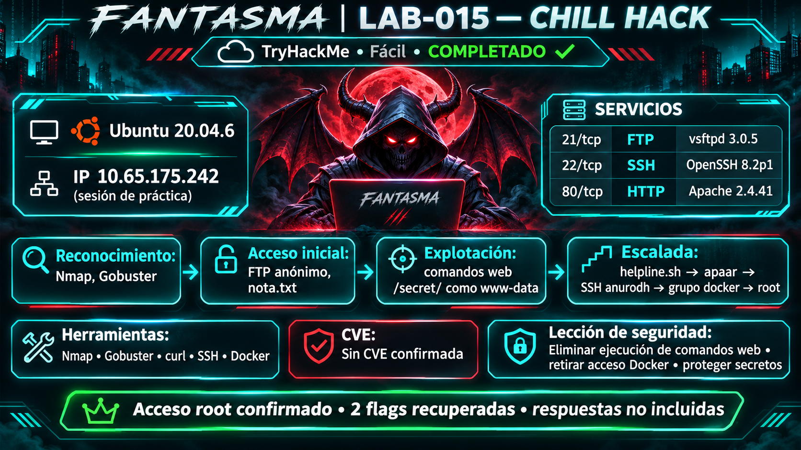

# LAB-015 — CHILL HACK

| Campo | Detalle |
|---|---|
| Plataforma | TryHackMe |
| Máquina | Chill Hack |
| Dificultad | Fácil |
| Estado de la máquina | Completada. Acceso `root` confirmado |
| Estado de envío | Se recuperaron las dos banderas. No se verificó su aceptación en TryHackMe |
| Sistema operativo | Ubuntu 20.04.6 LTS |
| IP de esta sesión | `10.65.175.242` (IP dinámica del laboratorio) |
| CVE | No se verificó una CVE aplicable a los hallazgos |
| Banderas | User y Root recuperadas. Valores omitidos |
| Autor | FANTASMA — [fantasmakm4](https://github.com/fantasmakm4) |

## Objetivo

Enumerar la superficie de Chill Hack, obtener acceso inicial, elevar privilegios y recuperar las banderas de usuario y root sin publicar sus valores.

## Cadena de ataque

FTP anónimo y nota → enumeración web → formulario de comandos `/secret/` como `www-data` → script `helpline.sh` ejecutado como `apaar` → SSH como `anurodh` → grupo `docker` → shell root.

## Información técnica

| Puerto | Servicio | Banner observado |
|---|---|---|
| 21/tcp | FTP | vsftpd 3.0.5, inicio anónimo habilitado |
| 22/tcp | SSH | OpenSSH 8.2p1 Ubuntu 4ubuntu0.13 |
| 80/tcp | HTTP | Apache httpd 2.4.41 (Ubuntu) |

El escaneo de los 1.000 puertos TCP más comunes confirmó abiertos 21, 22 y 80. La configuración de Apache contenía un VirtualHost con `DocumentRoot /var/www/files` y puerto 9001 local. Los intentos desde Parrot al puerto 9001 fueron rechazados, por lo que no se documenta como servicio remoto accesible.

## Metodología y hallazgos

1. **Reconocimiento.** Nmap identificó FTP, SSH y HTTP. FTP permitió acceso anónimo y expuso `note.txt`.
2. **Enumeración.** Gobuster encontró `/secret/`. La nota FTP anticipaba filtrado de texto en comandos.
3. **Explotación.** El formulario POST de `/secret/` ejecutaba comandos como `www-data`. Se verificó con `id`, `pwd` y `whoami`. El filtro compara tokens contra una lista de bloqueo, una protección insuficiente.
4. **Acceso como `apaar`.** `sudo -l` permitió ejecutar `/home/apaar/.helpline.sh` como `apaar`. El script ejecutaba directamente el mensaje introducido. Se recuperó la bandera de usuario.
5. **Acceso como `anurodh`.** Se validó el acceso SSH de la cuenta y se comprobó que pertenecía al grupo `docker`.
6. **Escalada a root.** Docker permitió montar el sistema raíz del anfitrión en un contenedor y ejecutar `chroot`. `whoami` confirmó `root`, y se recuperó la bandera root.

## Herramientas y comandos ejecutados

Nmap, Gobuster, curl, Firefox, SSH, Docker, `find`, `grep`, `sed`, `mysql`, `sudo`, `printf`, `id`, `pwd`, `whoami` y `wc`.

Reconocimiento inicial:

```bash
sudo nmap -Pn -sV -sC -T4 -p21,22,80 10.65.175.242
sudo nmap -Pn --top-ports 1000 -T4 10.65.175.242
gobuster dir -u http://10.65.175.242 -w /usr/share/wordlists/dirb/common.txt
```

Enumeración de FTP y ejecución web observadas:

```bash
curl -sS --user anonymous:anonymous ftp://10.65.175.242/note.txt
curl -sS -X POST -d 'command=id' http://10.65.175.242/secret/
curl -sS -X POST -d 'command=sudo -l' http://10.65.175.242/secret/
```

Escalada final observada:

```bash
docker run -v /:/mnt --rm -it alpine chroot /mnt /bin/sh
```

## Resultado

Acceso root confirmado. Las dos banderas fueron recuperadas, pero sus contenidos no se incluyen. La aceptación de las respuestas en el cuestionario de TryHackMe no se verificó.

## Documentación

- [Informe técnico completo](01-Informes/Informe-Pentesting.md)
- [Sala oficial Chill Hack](https://tryhackme.com/room/chillhack)

## Recomendaciones de seguridad

- Eliminar la ejecución de comandos del sistema desde formularios web. Aplicar validación por lista permitida y APIs seguras.
- No ejecutar entradas de usuario como código shell en scripts.
- Reducir las reglas sudo al mínimo privilegio y limitar los argumentos permitidos.
- Retirar las cuentas ordinarias del grupo Docker, que permite control equivalente a root.
- Retirar secretos del código fuente, restringir su acceso y rotar credenciales expuestas.
- Restringir servicios locales a interfaces y redes necesarias.
